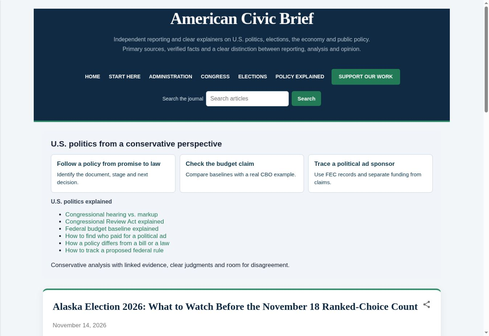

# American Civic Brief

## Apresentação e objetivo
Organizar publicações em inglês sobre assuntos cívicos e economia dos EUA.

## Participação real e inteligência artificial
Daniel de Omena Loubaque é responsável pelos objetivos, decisões de produto e acompanhamento do projeto. Desenvolvimento e documentação contam com IA; não se afirma autoria manual exclusiva nem experiência formal como desenvolvedor contratado.

## Tecnologias utilizadas
Blogger e automação editorial assistida por IA. Tecnologias identificadas no projeto não equivalem a domínio avançado individual.

## Arquitetura
Blog hospedado no Blogger; rotina editorial externa de pesquisa, redação e publicação. Cópias editoriais e documentação operacional são mantidas em repositório privado.

## Funcionalidades
Conteúdo editorial, fontes e rotina de publicação configurada.

## Demonstração
https://americancivicbrief.blogspot.com/

## Capturas de tela
As capturas devem mostrar páginas públicas, sem sessões, tokens ou dados de terceiros. Consulte as imagens reais disponíveis no pacote do portfólio; nenhuma imagem sintética é apresentada como captura.

## Instalação
Não há aplicação própria para instalar. Administração e exportação de tema/conteúdo dependem do acesso ao Blogger.

## Testes e limites de validação
Checar fontes, data dos eventos, autoria assistida por IA, links e consistência editorial. Operação atual não testada nesta fase.

## Desafios técnicos
Verificar fatos atuais e distinguir análise de informação comprovada.

## Soluções implementadas
Uso de fontes, pesquisa e revisão no fluxo editorial; não há promessa de aprovação AdSense ou receita.

## Próximas melhorias
Verificar políticas editoriais, páginas institucionais, transparência e qualidade do conteúdo.

## Segurança
Este documento foi escrito para publicação, sem copiar histórico, credenciais ou dados comerciais privados. Os originais privados permanecem privados. Auditoria documental em 14/11/2026; não constitui garantia de ausência de vulnerabilidades.

## Contato
[Daniel no GitHub](https://github.com/Danielloubaque) · [LinkedIn](https://www.linkedin.com/in/daniel-loubaque-58443a240/) · [Vyntriva Tech](https://vyntriva-tech.onrender.com/)

## Captura real da página pública

## Software House & Digital Solutions — 15/11/2026

Este projeto integra o portfólio técnico da Vyntriva Tech, conduzida pelo fundador e CEO Daniel Loubaque com apoio de IA. Serviços de Front-end, Back-end, Full Stack, automação e integrações são definidos por escopo e viabilidade; esta documentação não afirma domínio avançado nem resultados comerciais.

Site oficial: https://vyntriva-tech.onrender.com/ · Estudos técnicos: https://vyntriva-tech.onrender.com/portfolio.html

As capturas existentes representam o projeto na data da preparação. Automações e integrações precisam de verificação individual antes de serem apresentadas como operacionais.
